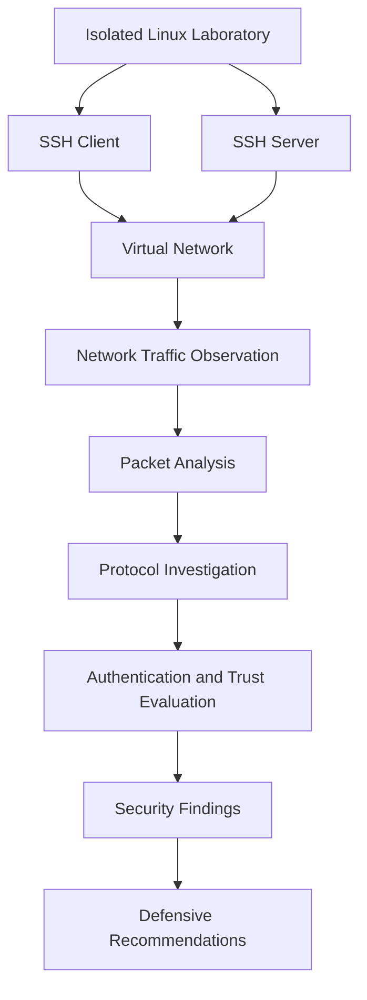

# Network Security — SSH and Man-in-the-Middle Analysis


## Abstract

This project presents an experimental network security investigation
of Man-in-the-Middle (MitM) scenarios involving SSH communications
within a virtualized GNU/Linux environment.

The investigation focuses on network trust relationships,
Address Resolution Protocol (ARP) vulnerabilities, packet analysis,
secure communication protocols, and endpoint authentication.

The project examines the security implications of compromised
network trust and the importance of identity verification,
network isolation, and defensive security mechanisms.

Originally developed as a Computer and Communication Systems
Security project at the Department of Computer Science and
Engineering, University of Ioannina.

---

## Table of Contents

- [Project Objectives](#project-objectives)
- [System Architecture](#system-architecture)
- [Core Capabilities](#core-capabilities)
- [Technical Investigation](#technical-investigation)
- [Experimental Environment](#experimental-environment)
- [Repository Structure](#repository-structure)
- [Validation Methodology](#validation-methodology)
- [Defensive Security Considerations](#defensive-security-considerations)
- [Project Status and Limitations](#project-status-and-limitations)
- [Development Roadmap](#development-roadmap)
- [Responsible Use](#responsible-use)
- [Technical References](#technical-references)
- [Contributing](#contributing)
- [Academic Attribution](#academic-attribution)
- [Author](#author)
- [License](#license)

---

## Project Objectives

The primary objectives of this project are to:

- Investigate network trust relationships within GNU/Linux environments.
- Examine security limitations associated with ARP.
- Understand SSH communication and endpoint authentication.
- Analyze Ethernet, IPv4, and TCP network traffic.
- Investigate Man-in-the-Middle security scenarios.
- Evaluate the importance of cryptographic identity verification.
- Develop practical experience with Linux network diagnostic tools.
- Document experimental observations and defensive security considerations.

## System Architecture

The following diagram illustrates the conceptual architecture
of the network security investigation.



The architecture represents the conceptual relationship between
the laboratory environment, network communication, protocol
analysis, and security evaluation.

## Core Capabilities

| Capability | Description |
|---|---|
| Network traffic analysis | Inspection of network communication within an isolated environment. |
| ARP security analysis | Investigation of local network address-resolution trust. |
| SSH protocol analysis | Examination of encrypted communication and endpoint authentication. |
| Packet inspection | Analysis of Ethernet, IPv4, and TCP protocol structures. |
| Linux networking | Investigation of network interfaces, virtual bridges, and packet-processing behavior. |
| Authentication analysis | Examination of endpoint identity and cryptographic trust. |
| Security documentation | Recording and interpretation of experimental observations. |
| Defensive evaluation | Investigation of mechanisms intended to mitigate network security risks. |

## Technical Investigation

### Address Resolution Protocol

ARP is responsible for resolving IPv4 addresses to link-layer
hardware addresses within a local network.

The investigation examines the security implications of
ARP's inherent trust model and the consequences of incorrect
address-resolution information.

### Secure Shell Protocol

SSH provides encrypted and authenticated communication
between networked systems.

The investigation examines:

- Client-server communication.
- Cryptographic key exchange.
- Server identity verification.
- Authentication mechanisms.
- Encrypted session establishment.
- Network-level trust relationships.

Network traffic redirection does not independently defeat
SSH encryption. Correct endpoint identity verification
is fundamental to preventing server impersonation.

### Network Traffic Analysis

Wireshark is used to investigate network communication
and inspect protocol-level information.

The analysis focuses on:

- Ethernet frames.
- ARP messages.
- IPv4 packets.
- TCP segments.
- SSH protocol behavior.
- Network communication patterns.

### Linux Networking

The experimental environment incorporates Linux networking
components and established security analysis utilities.

The investigation explores virtual network interfaces,
network bridges, firewall mechanisms, and communication
between isolated laboratory systems.

The project uses existing networking and security tools
rather than implementing a new networking protocol or
interception framework.

## Experimental Environment

### Technical Specifications

| Component | Technology |
|---|---|
| Operating system | GNU/Linux |
| Processor architecture | x86-64 |
| Linux kernel | 6.12.57 |
| Network environment | Virtualized Linux laboratory |
| Network topology | Virtual bridge and isolated systems |
| Communication protocol | SSH |
| Transport protocol | TCP |
| Address resolution | ARP |
| Packet analysis | Wireshark |
| Network security analysis | Ettercap |
| Firewall management | iptables |
| SSH security investigation | SSH-MITM |

The environment specifications originate from the
original academic project documentation.

Independent reproduction of the complete environment
remains subject to further verification.

## Repository Structure

```text
Network-Security-MitM/
├── docs/                  # Academic and technical documentation
├── .gitattributes         # Git attributes configuration
├── CHANGELOG.md           # Project change history
├── CODE_OF_CONDUCT.md     # Community conduct guidelines
├── CONTRIBUTING.md       # Contribution guidelines
├── LICENSE               # Repository licensing information
└── README.md             # Project documentation
```

The repository primarily contains academic documentation
and experimental analysis rather than a standalone
software implementation.

## Validation Methodology

A reproducible evaluation should investigate network
behavior, protocol interpretation, and the effectiveness
of relevant defensive mechanisms.

### Functional Validation

| Test Scenario | Validation Objective |
|---|---|
| Baseline communication | Establish expected network behavior. |
| ARP communication | Examine address-resolution consistency. |
| SSH session establishment | Evaluate expected connection behavior. |
| Endpoint verification | Investigate server identity validation. |
| Packet inspection | Verify protocol identification and interpretation. |
| Network isolation | Evaluate laboratory environment boundaries. |
| Defensive configuration | Examine the effectiveness of security controls. |

These scenarios represent a proposed validation framework,
not a claim that an automated test suite has been executed.

### Experimental Evidence

A structured security investigation should document:

- Laboratory environment configuration.
- Network topology.
- Software and tool versions.
- Relevant protocol observations.
- Sanitized network capture evidence.
- Authentication behavior.
- Experimental limitations.
- Defensive recommendations.

No independently verified security effectiveness or
quantitative performance guarantees are claimed.

## Defensive Security Considerations

The investigation highlights several important principles
of defensive network security.

| Security Mechanism | Purpose |
|---|---|
| SSH host-key verification | Establish the identity of the remote server. |
| Trusted authentication | Reduce unauthorized access risks. |
| Network segmentation | Limit exposure between network systems. |
| ARP inspection | Detect or prevent invalid address-resolution information. |
| Firewall policies | Restrict unauthorized network communication. |
| Network monitoring | Identify suspicious communication patterns. |
| Security updates | Address known software vulnerabilities. |
| Least privilege | Limit the consequences of compromised access. |

Encryption must be combined with appropriate authentication,
trusted configuration, and endpoint identity verification.

## Project Status and Limitations

This project is an experimental academic network
security investigation.

The following areas require further verification:

- Reproducibility of the original laboratory environment.
- Compatibility with contemporary Linux distributions.
- Compatibility with current security analysis tools.
- Independent verification of experimental observations.
- Systematic evaluation of defensive mechanisms.
- Automated validation procedures.
- Third-party software and documentation licensing.

The repository does not constitute a standalone
network security application.

The project is not intended for production deployment.

## Development Roadmap

- [ ] Document the complete laboratory environment.
- [ ] Record compatible software and tool versions.
- [ ] Establish reproducible network analysis procedures.
- [ ] Prepare sanitized experimental evidence.
- [ ] Validate protocol-level observations.
- [ ] Evaluate SSH endpoint verification mechanisms.
- [ ] Investigate defensive network configurations.
- [ ] Establish structured validation procedures.
- [ ] Verify third-party licensing and attribution.
- [ ] Publish independently reproducible findings.

## Responsible Use

This project is intended exclusively for academic research,
cybersecurity education, defensive security analysis,
and authorized experimentation.

All experimental activities must be restricted to isolated
environments and systems for which explicit authorization
has been obtained.

Sensitive information, authentication credentials, and
private communication data must not be disclosed.

## Technical References

### External Resources

- [Linux Kernel Documentation](https://docs.kernel.org/)
- [OpenSSH](https://www.openssh.com/)
- [Wireshark Documentation](https://www.wireshark.org/docs/)
- [RFC 826 — Address Resolution Protocol](https://www.rfc-editor.org/rfc/rfc826)
- [RFC 9293 — Transmission Control Protocol](https://www.rfc-editor.org/rfc/rfc9293)
- [RFC 4251 — SSH Protocol Architecture](https://www.rfc-editor.org/rfc/rfc4251)
- [RFC 4253 — SSH Transport Layer Protocol](https://www.rfc-editor.org/rfc/rfc4253)
- [Netfilter Project](https://www.netfilter.org/)
- [CWE-300 — Channel Accessible by Non-Endpoint](https://cwe.mitre.org/data/definitions/300.html)

### Academic Documentation

The original academic project materials and technical
documentation are available in the [docs](docs/) directory.

## Contributing

Contributions related to network security analysis,
protocol documentation, defensive security mechanisms,
experimental reproducibility, and technical accuracy
are welcome.

Please refer to the following documents before
submitting changes:

- [Contribution Guidelines](CONTRIBUTING.md)
- [Code of Conduct](CODE_OF_CONDUCT.md)
- [Changelog](CHANGELOG.md)

## Academic Attribution

This project was originally developed as part of the
Computer and Communication Systems Security coursework at:

**Department of Computer Science and Engineering**  
University of Ioannina  
Ioannina, Greece

**Course:** MYE007 — Security of Computer and Communication Systems

## Author

| Author | Affiliation | GitHub |
|---|---|---|
| Christos-Grigorios Gkovaris | University of Ioannina | [@ChristosGkovaris](https://github.com/ChristosGkovaris) |

## License

Original project contributions are subject to the licensing
terms specified in the [LICENSE](LICENSE) file, where the
author holds the necessary rights.

Third-party software, instructor-provided materials,
academic specifications, and external resources remain
subject to their respective licensing and copyright terms.

A complete licensing and redistribution review
remains pending.